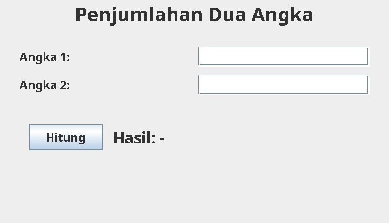

# Tugas GUI Swing & AWT - Penjumlahan Dua Angka

Aplikasi sederhana untuk latihan lima komponen utama GUI: top-level container, intermediate container, atomic component, layout, dan event listener.



## Identitas

- **NIM:** F1D02410115
- **Nama:** Kevin Adiwiguna
- **Repositori:** Latihan-GUI-F1D202410115

## 5 Komponen Utama GUI

| Komponen | Class / Interface | File |
|---|---|---|
| **1. Top-level Container** | `MainFrame extends JFrame` - jendela utama aplikasi. | `src/MainFrame.java` |
| **2. Intermediate Container** | `FormPanel extends JPanel` - wadah untuk input, tombol, dan hasil. | `src/FormPanel.java` |
| **3. Atomic Component** | `JLabel`, `JTextField`, `JButton` - komponen daun di dalam panel. | `src/FormPanel.java` |
| **4. Layout** | `BorderLayout` (frame & panel), `GridLayout` (baris input), `FlowLayout` (tombol & hasil). | `src/MainFrame.java`, `src/FormPanel.java` |
| **5. Event Listener** | `ActionListener` - method `actionPerformed()` di-override untuk tombol **Hitung**. | `src/FormPanel.java` |

## Struktur

```text
gui-swing-awt/
├── src/
│   ├── Main.java       # entry point
│   ├── MainFrame.java  # top-level container (JFrame)
│   └── FormPanel.java  # intermediate container + ActionListener
├── docs/screenshot.png
├── run.sh
└── README.md
```

## Cara Menjalankan

```bash
./run.sh
```

Atau manual:

```bash
javac -d out src/*.java
java -cp out Main
```

Isi dua angka, lalu tekan **Hitung** untuk melihat hasil penjumlahan.

## Format Balasan Diskusi

```text
NIM : F1D02410115
Nama : Kevin Adiwiguna
Link Repositori GitHub : https://github.com/KevinAdiwiguna/Latihan-GUI-F1D202410115
```
